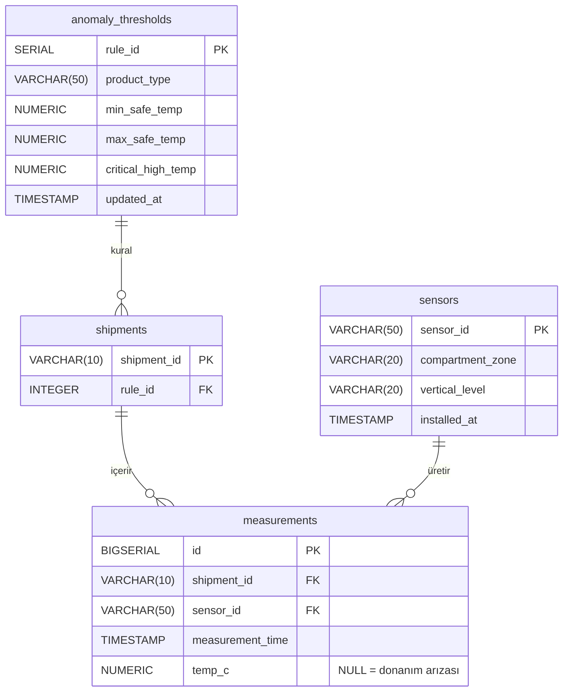

# Çilek IoT Soğuk Zinciri Telemetri Analizi

[🇹🇷 Türkçe](README.md) | [🇬🇧 English](readme/README.en.md) | [🇩🇪 Deutsch](readme/README.de.md) | [🇫🇷 Français](readme/README.fr.md) | [🇮🇹 Italiano](readme/README.it.md) | [🇪🇸 Español](readme/README.es.md) | [🇨🇳 中文](readme/README.zh-CN.md)

Bu proje, S1-S6 sevkiyatlarında dokuz IoT sensöründen toplanan sıcaklık
telemetrisini ilişkisel bir yapıya dönüştürür ve PostgreSQL üzerinde temel
veri kalitesi ve anomali analizlerine hazırlar. Operasyonel hikâye, problem
tanımı ve ana araştırma sorusu [SCENARIO.md](SCENARIO.md) dosyasındadır;
bu README teknik veri akışını ve çalıştırma adımlarını açıklar.

## Proje kapsamı

- **Veri seti:** S1-S6 sevkiyatları, 9 sensör, 14.398 ham zaman kaydı
- **Ham şema:** 37 sütun, Apache Parquet
- **İşlenmiş çıktı:** 129.582 uzun-format ölçüm satırı
- **Güvenli sıcaklık aralığı:** 0.0°C-4.0°C
- **Hedef veritabanı:** PostgreSQL
- **Ders kapsamı:** Vize için Hafta 3-5 veri hazırlama, tablo tasarımı ve SQL analizleri

Detaylı kaynak, lisans, kalite kuralları ve dosya yapısı için
[veri kartına](data/dataREADME.md) bakın.

AI tabanlı bir model veya tamamlanmış bir AI özelliği bu sürümün parçası
değildir. Kullanılan araçların ve öğrencinin katkısının açıklaması için
[AI_BEYAN.md](AI_BEYAN.md) dosyasına bakın.

## Veri kaynağı ve dosya yapısı

Veri, Hugging Face üzerindeki [Cold-Chain Transportation Strawberry
Dataset](https://huggingface.co/datasets/NifferLi/Cold-Chain-Transportation-Strawberry)
kaynaklıdır. Altı Parquet dosyası `data/original/` altında ham hâliyle
korunur; elle değiştirilmez.

```text
vize-202607131002/
├── data/
│   ├── original/                 # S1-S6 Parquet dosyaları
│   └── processed/                # data/processed/
│       └── measurements.csv      # Uzun-format çıktı
├── python/                      # Okuma, doğrulama, dönüşüm ve aktarım betikleri
├── sql/                         # PostgreSQL şeması ve analiz sorguları
├── SCENARIO.md                  # Hikâye, problem ve ana soru
├── SCENARIO.en.md               # İngilizce senaryo
└── AI_BEYAN.md                  # AI kullanım beyanı
```

## Teknik veri akışı

1. `python/01_read_files.py`, `data/original/*.parquet` dosyalarını bulur,
   okunabilirliklerini ve satır sayılarını kontrol eder.
2. `python/02_verify_schema.py`, S1-S6 dosyalarının sütun adlarını ve sırasını
   karşılaştırır; ortak 37 sütunluk şemayı doğrular.
3. `python/python03_find_errors.py`, sensör alanlarındaki `-999.00` donanım
   hata kodlarını tarar. Bu değerler gerçek sıcaklık değildir ve veri kalitesi
   sorunu olarak ele alınır.
4. `python/04_process_data.py`, dokuz sensör sütununu `pandas.melt()` ile
   geniş formattan uzun formata çevirir. Çıktı sütunları
   `shipment_id`, `measurement_time`, `sensor_id` ve `temp_c` olur.
5. `python/05_import_data.py`, CSV dosyasını PostgreSQL'e aktarır; boş
   değerleri ve `-999` değerlerini `NULL` olarak yükler ve 129.582 satırı
   doğrular.

Özetle, bir ham satır aynı zaman kaydındaki dokuz sensörü yan yana taşırken,
uzun formattaki her satır tek bir sensör ölçümünü temsil eder:

```text
14.398 ham kayıt × 9 sensör = 129.582 ölçüm
```

## PostgreSQL ve SQL kapsamı

`sql/` klasöründeki dosyalar ders haftalarına göre ayrılmıştır:

- `sql/sql01_create_tables.sql`: `measurements` tablosu ve sorgu indeksleri
- `sql/02_import_data.sql`: aktarım sonrası satır sayısı kontrolü
- `sql/05_anomaly_thresholds.sql`: sıcaklık eşiklerinin parametreleştirilmesi
- `sql/hafta-04.sql`: Hafta 4 temel tablo ve veri sorguları
- `sql/hafta-05.sql`: Hafta 5 gruplama, zaman ve anomali analizleri
- `sql/sql06_ai_anomaly_view.sql`: gelecekteki AI/anomali görünümü için hazırlık

`measurements.temp_c` alanı `NUMERIC` olarak tutulur. `-999` değerlerini
ortalama ve eşik analizlerini bozmayacak şekilde `NULL` yapmak, ölçüm yokluğu
ile gerçek sıcaklığı birbirinden ayırır. AI görünümü bir hazırlık/gelecek
çalışmasıdır; tamamlanmış bir model olarak sunulmaz.

## Yeniden üretilebilirlik

Komutları proje kök dizininden çalıştırın:

```bash
python python/01_read_files.py
python python/02_verify_schema.py
python python/python03_find_errors.py
python python/04_process_data.py
python python/05_import_data.py
```

Son adım için PostgreSQL bağlantı bilgileri `PGHOST`, `PGPORT`, `PGDATABASE`,
`PGUSER` ve `PGPASSWORD` ortam değişkenleriyle verilebilir. Varsayılan
veritabanı adı `strawberry_db`, port ise `5432`'dir. SQL dosyalarını
PostgreSQL istemcisiyle, aktarım betiğinden sonra çalıştırın.

## Veri kalitesi notları

- Ham Parquet dosyaları kaynak verinin değişmez kopyasıdır.
- `-999.00` sensör donanım hata kodudur; geçerli sıcaklık olarak
  yorumlanmamalıdır.
- Eksik veya geçersiz ölçümler SQL tarafında `NULL` olarak saklanır.
- 0.0°C-4.0°C güvenli aralık, 8.0°C üzeri ise kritik kayıp eşiği olarak
  değerlendirilir; ayrıntılı yorumlar SQL sorgularında yapılır.


  ## Veri Modeli

### 2.1 Güncel ERD

Vizede `SCENARIO.md` içinde üç tablo adayı vardı (`sensors`, `measurements`, `anomaly_thresholds`). Bu ödevde `shipments` tablosunu ekledim ve eşik kuralını sevkiyata bağladım.



İlişkiler:

- `anomaly_thresholds` - `shipments` (1-N): Bir kural, en az sıfır, en çok sınırsız sevkiyata uygulanır; bir sevkiyat, tam olarak bir kurala bağlıdır.
- `shipments` - `measurements` (1-N): Bir sevkiyat, en az sıfır, en çok sınırsız ölçüme sahiptir; bir ölçüm, tam olarak bir sevkiyata aittir.
- `sensors` - `measurements` (1-N): Bir sensör, en az sıfır, en çok sınırsız ölçüm üretir; bir ölçüm, tam olarak bir sensörden gelir.

`measurements` tablosunda (`shipment_id`, `sensor_id`, `measurement_time`) üçlüsü ayrıca `UNIQUE` tutulacak; böylece aynı ölçüm iki kez yüklenemez.

Sevkiyat ile sensör arasında dolaylı bir M-N ilişki var (bir sevkiyatta dokuz sensör ölçer, bir sensör altı sevkiyatta kullanılır). Bu ilişkiyi `measurements` tablosu taşıyor; ara tablo görevi görüyor ve ek olarak zaman ve sıcaklık verisini tutuyor.

### 2.2 Normalizasyon notu

| Tablo | Neden ayrıldı / ayrılmadı | Form |
|---|---|---|
| Ham Parquet (37 sütun) | Dokuz sensör sütunu yan yana duruyordu (`Front_Top` ... `Rear_Bottom`), bu tekrarlayan bir gruptu. `pandas.melt()` ile her satıra tek ölçüm gelecek şekilde `measurements` oluşturuldu. | 1NF'ye ulaşmak için dönüştürüldü |
| `measurements` | Aday anahtar (`shipment_id`, `sensor_id`, `measurement_time`) sıcaklığı belirliyor. Her sütun tek değer taşıyor, `temp_c` tek bir ölçüm. Bölge ve seviye bu tabloda tutulsaydı yalnızca `sensor_id`'ye bağlı olurdu (kısmi bağımlılık), o yüzden `sensors`'a taşındı. | 1NF ve 2NF |
| `sensors` | `compartment_zone` ve `vertical_level` sensörün kimliğiyle belirleniyor (`Front_Top` ise `Front` ve `Top`). Bölge seviyeyi belirlemiyor, seviye de bölgeyi belirlemiyor, yani aralarında geçişli bağımlılık yok. | 3NF |
| `shipments` ve `anomaly_thresholds` | Eşik değerleri (`min_safe_temp`, `max_safe_temp`, `critical_high_temp`) ürün kuralına bağlı. `measurements` içinde tutulsaydı `measurement_time` → `shipment_id` → `rule_id` → eşikler zinciriyle geçişli bağımlılık oluşurdu. Bu yüzden kural ayrı tabloda, sevkiyat ona `rule_id` ile bağlanıyor. | 3NF |

Bir sütunun hangisini belirlediği: `sensor_id` → `compartment_zone`, `vertical_level`; `shipment_id` → `rule_id`; `rule_id` → üç eşik değeri.

### 2.3 İki JOIN sorusu

**Soru 1.** Her ölçümün hangi bölgedeki sensörden geldiği bilinirse, 8.0°C üstü kritik ihlaller bölgelere (`Front`, `Middle`, `Rear`) göre nasıl dağılıyor?

- Birleşen tablolar: `measurements m` ve `sensors s`
- Birleştirme koşulu: `m.sensor_id = s.sensor_id`
- JOIN türü: `INNER JOIN`. Her ölçümün `sensor_id` değeri zorunlu ve `sensors` tablosunda karşılığı var, bu yüzden hiçbir satır kaybolmaz.
- Çıktı: `s.compartment_zone` başına `count(*)` (`WHERE m.temp_c > 8.0`).

**Soru 2.** Hiç ölçüm kaydı olmayan sensör veya sevkiyat var mı?

- Birleşen tablolar: `sensors s` ve `measurements m`
- Birleştirme koşulu: `s.sensor_id = m.sensor_id`
- JOIN türü: `LEFT JOIN`, ardından `WHERE m.id IS NULL`. Soldaki tablo `sensors` olmalı, çünkü aranan şey sağ tarafta eşleşmesi olmayan sensör. `INNER JOIN` kullansaydım hiç ölçüm üretmemiş sensör sonuçtan kaybolurdu ve soruyu cevaplayamazdım. Aynı soru `shipments` için `shipments s LEFT JOIN measurements m ON s.shipment_id = m.shipment_id` ile sorulabilir.

